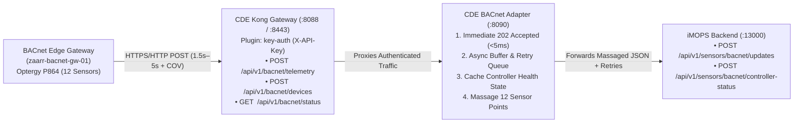

# CDE BACnet Ingestion & Transformation Setup Guide (`zaarr-bacnet-gw-01` ➔ CDE ➔ iMOPS)

This guide provides step-by-step instructions to provision the **Kong API Gateway (`:8088`)** routes, `X-API-Key` authentication, and the **CDE BACnet Transformation Adapter (`:8090`)** that receives telemetry from the **Smart Nation Exhibition System BACnet Edge Gateway (`zaarr-bacnet-gw-01`)**, massages the 12 Optergy P864 sensor points, and forwards them to **iMOPS**.

---

## 1. Architecture Flow



---

## 2. Prerequisites

Ensure the **Kong API Gateway** and **CDE Data Mart / Adapter** containers are running on `cde-network`:

```powershell
# 1. Start Kong Gateway (if not already running)
cd c:\Projects\cde\apigw
docker compose up -d

# 2. Start CDE Adapter & Data Mart Service (if not already running)
cd c:\Projects\cde\datamart
docker compose up -d
```

---

## 3. Automated Route & Adapter Setup (Recommended)

Use the provisioning scripts in `apigw/scripts/` to configure Kong Gateway and set the target **iMOPS IP** in one command.

* **PowerShell Script:** [apigw/scripts/setup_bacnet_ingestion.ps1](file:///c:/Projects/cde/apigw/scripts/setup_bacnet_ingestion.ps1)
* **Bash Script:** [apigw/scripts/setup_bacnet_ingestion.sh](file:///c:/Projects/cde/apigw/scripts/setup_bacnet_ingestion.sh)

### Option A: PowerShell (Windows)

```powershell
cd c:\Projects\cde

# Pass the target iMOPS IP address (defaults to port 13000 if no port is specified):
.\apigw\scripts\setup_bacnet_ingestion.ps1 -ImopsIp "10.65.51.252"

# Or specify custom IP:Port and custom X-API-Key secret:
.\apigw\scripts\setup_bacnet_ingestion.ps1 `
  -ImopsIp "10.65.51.252:13000" `
  -ApiKey "zaarr-bacnet-gw01-key-2026"

# For local Docker testing on the same machine:
.\apigw\scripts\setup_bacnet_ingestion.ps1 -ImopsIp "localhost:13000"
```

### Option B: Bash (Linux / macOS / WSL)

```bash
cd /c/Projects/cde
chmod +x apigw/scripts/setup_bacnet_ingestion.sh

# Usage: ./setup_bacnet_ingestion.sh [IMOPS_IP] [API_KEY]
./apigw/scripts/setup_bacnet_ingestion.sh 10.65.51.252 zaarr-bacnet-gw01-key-2026
```

### How the `ImopsIp` Parameter Is Resolved
| Input Parameter (`-ImopsIp` / `$1`) | Resolved Outbound iMOPS Base URL |
| :--- | :--- |
| `"10.65.51.252"` | `http://10.65.51.252:13000` |
| `"10.65.51.252:13000"` | `http://10.65.51.252:13000` |
| `"https://imops.example.com"` | `https://imops.example.com` |
| `"localhost:13000"` or `"127.0.0.1"` | `http://host.docker.internal:13000` *(Docker bridge)* |

---

## 4. What Gets Provisioned in Kong & CDE

| Component | Name | Configuration |
| :--- | :--- | :--- |
| **Kong Service** | `cde-bacnet-adapter-service` | Upstream URL: `http://cde-datamart-etl:8090` |
| **Kong Route 1** | `bacnet-telemetry-route` | `POST /api/v1/bacnet/telemetry` (`strip_path: false`) |
| **Kong Route 2** | `bacnet-devices-route` | `POST /api/v1/bacnet/devices` (`strip_path: false`) |
| **Kong Route 3** | `bacnet-status-route` | `GET /api/v1/bacnet/status` (`strip_path: false`) |
| **Plugin: `key-auth`** | `key-auth` | Accepts `X-API-Key`, `x-api-key`, or `apikey` (`hide_credentials: true`) |
| **Plugin: `rate-limiting`** | `rate-limiting` | `600` requests/minute (`policy: local`) |
| **Plugin: `request-size-limiting`** | `request-size-limiting` | `5 MB` max payload |
| **Plugin: `correlation-id`** | `correlation-id` | Header `X-Request-ID` (`uuid`, echoed downstream) |
| **Kong Consumer** | `zaarr-bacnet-gw-01` | `X-API-Key`: `zaarr-bacnet-gw01-key-2026` |

---

## 5. Manual Setup Commands (`curl`)

If you need to provision or update the routes manually without running the script:

```bash
# 1. Create Kong Service pointing to CDE BACnet Adapter (:8090)
curl.exe -i -X POST http://localhost:8001/services \
  -H "Content-Type: application/json" \
  -d "{\"name\":\"cde-bacnet-adapter-service\",\"url\":\"http://cde-datamart-etl:8090\"}"

# 2. Create Route A: POST /api/v1/bacnet/telemetry
curl.exe -i -X POST http://localhost:8001/services/cde-bacnet-adapter-service/routes \
  -H "Content-Type: application/json" \
  -d "{\"name\":\"bacnet-telemetry-route\",\"paths\":[\"/api/v1/bacnet/telemetry\"],\"methods\":[\"POST\",\"OPTIONS\"],\"strip_path\":false}"

# 3. Create Route B: POST /api/v1/bacnet/devices
curl.exe -i -X POST http://localhost:8001/services/cde-bacnet-adapter-service/routes \
  -H "Content-Type: application/json" \
  -d "{\"name\":\"bacnet-devices-route\",\"paths\":[\"/api/v1/bacnet/devices\"],\"methods\":[\"POST\",\"OPTIONS\"],\"strip_path\":false}"

# 4. Create Route C: GET /api/v1/bacnet/status
curl.exe -i -X POST http://localhost:8001/services/cde-bacnet-adapter-service/routes \
  -H "Content-Type: application/json" \
  -d "{\"name\":\"bacnet-status-route\",\"paths\":[\"/api/v1/bacnet/status\"],\"methods\":[\"GET\",\"OPTIONS\"],\"strip_path\":false}"

# 5. Enable key-auth Plugin (accepting X-API-Key header)
curl.exe -i -X POST http://localhost:8001/services/cde-bacnet-adapter-service/plugins \
  -H "Content-Type: application/json" \
  -d "{\"name\":\"key-auth\",\"config\":{\"key_names\":[\"X-API-Key\",\"x-api-key\",\"apikey\"],\"hide_credentials\":true}}"

# 6. Create Consumer & Provision X-API-Key
curl.exe -i -X POST http://localhost:8001/consumers \
  -H "Content-Type: application/json" \
  -d "{\"username\":\"zaarr-bacnet-gw-01\",\"custom_id\":\"smart-nation-bacnet-gw-01\"}"

curl.exe -i -X POST http://localhost:8001/consumers/zaarr-bacnet-gw-01/key-auth \
  -H "Content-Type: application/json" \
  -d "{\"key\":\"zaarr-bacnet-gw01-key-2026\"}"

# 7. Point CDE Adapter to Target iMOPS IP (replace 10.65.51.252 with your iMOPS IP)
curl.exe -i -X POST http://localhost:8090/api/v1/bacnet/config \
  -H "Content-Type: application/json" \
  -d "{\"imopsBaseUrl\":\"http://10.65.51.252:13000\"}"
```

---

## 6. Updating iMOPS IP or Sensor ID Mapping at Runtime

You can update the target iMOPS IP, credentials, or `short_object_id` $\rightarrow$ `sensor_id` lookup table at any time without restarting containers by calling `POST /api/v1/bacnet/config` on `:8090`:

```bash
curl.exe -i -X POST http://localhost:8090/api/v1/bacnet/config \
  -H "Content-Type: application/json" \
  -d "{
    \"imopsBaseUrl\": \"http://10.65.51.252:13000\",
    \"imopsApiKey\": \"optional-imops-api-key\",
    \"sensorIdMap\": {
      \"AI-101\": \"AI-101\",
      \"BI-1\": \"BI-1\"
    }
  }"
```

---

## 7. How to Test `cde-bacnet-adapter-service`

### Option A: Automated 4-Step Test Script (Fastest)
Run [apigw/scripts/test_bacnet_ingestion.ps1](file:///c:/Projects/cde/apigw/scripts/test_bacnet_ingestion.ps1) to automatically test `401` auth blocking, `POST /api/v1/bacnet/devices`, `POST /api/v1/bacnet/telemetry`, and `GET /api/v1/bacnet/status`:

```powershell
cd c:\Projects\cde
.\apigw\scripts\test_bacnet_ingestion.ps1
```

### Option B: 1-Click Browser Live Status Check
Because Kong's `key-auth` plugin accepts `?apikey=...` in the query string as well as the `X-API-Key` header, open this link in your browser to inspect the live adapter state, cached Optergy P864 controller, latest 12 sensors, and MinIO Data Lake archive path:

* **[http://localhost:8088/api/v1/bacnet/status?apikey=zaarr-bacnet-gw01-key-2026](http://localhost:8088/api/v1/bacnet/status?apikey=zaarr-bacnet-gw01-key-2026)**

### Option C: Manual Step-by-Step `curl.exe` Commands

#### Step 1: Verify Unauthenticated Request Is Blocked (`401 Unauthorized`)
```bash
curl.exe -i -X POST http://localhost:8088/api/v1/bacnet/telemetry \
  -H "Content-Type: application/json" \
  -d "{}"
```
*Expected:* `HTTP/1.1 401 Unauthorized` (`{"message":"No API key found in request"}`).

#### Step 2: Send Controller Discovery / Health Status (`POST /api/v1/bacnet/devices`)
```powershell
curl.exe -i -X POST http://localhost:8088/api/v1/bacnet/devices -H "Content-Type: application/json" -H "User-Agent: zaarr-bacnet-gw/1.0" -H "X-API-Key: zaarr-bacnet-gw01-key-2026" --data-binary "@apigw/scripts/fixtures/bacnet_device.json"
```
*Expected:* `HTTP/1.1 202 Accepted` with `{"status":"accepted","device_id":864077,"online":true}`.

#### Step 3: Send Telemetry Batch (`POST /api/v1/bacnet/telemetry`)
```powershell
curl.exe -i -X POST http://localhost:8088/api/v1/bacnet/telemetry -H "Content-Type: application/json" -H "User-Agent: zaarr-bacnet-gw/1.0" -H "X-API-Key: zaarr-bacnet-gw01-key-2026" --data-binary "@apigw/scripts/fixtures/bacnet_telemetry.json"
```
*Expected:* `HTTP/1.1 202 Accepted` with `{"status":"accepted","batch_id":"20261113T012000Z-42","sensors_queued":2}`.

#### Step 4: Inspect Transformed Payload & Queue Delivery Status (`GET /api/v1/bacnet/status`)
```powershell
curl.exe -s http://localhost:8088/api/v1/bacnet/status -H "X-API-Key: zaarr-bacnet-gw01-key-2026"
```

---

## 8. Handover Deliverables for Edge Gateway (`zaarr-bacnet-gw-01`)

Provide the following API Gateway endpoints, headers, and configuration block to the **`zaarr-bacnet-gw-01`** edge gateway team so they can push data into CDE:

### 8.1 API Gateway Endpoints & Credentials Summary

| Setting | Value to Configure on `zaarr-bacnet-gw-01` |
| :--- | :--- |
| **API Gateway Base URL (HTTP)** | `http://<CDE_SERVER_IP>:8088` *(or `http://localhost:8088` for local testing)* |
| **API Gateway Base URL (HTTPS)** | `https://<CDE_SERVER_IP>:8443` |
| **1. Sensor Telemetry Push Endpoint** | **`POST /api/v1/bacnet/telemetry`**<br>Full URL: `http://<CDE_SERVER_IP>:8088/api/v1/bacnet/telemetry` |
| **2. Controller Discovery / Status Endpoint** | **`POST /api/v1/bacnet/devices`**<br>Full URL: `http://<CDE_SERVER_IP>:8088/api/v1/bacnet/devices` |
| **3. Status / Verification Endpoint (Optional)** | **`GET /api/v1/bacnet/status`**<br>Full URL: `http://<CDE_SERVER_IP>:8088/api/v1/bacnet/status?apikey=zaarr-bacnet-gw01-key-2026` |
| **Authentication Header** | `X-API-Key: zaarr-bacnet-gw01-key-2026` |
| **Content-Type Header** | `Content-Type: application/json` |
| **User-Agent Header** | `User-Agent: zaarr-bacnet-gw/1.0` |
| **Expected Success Status** | `HTTP 202 Accepted` (`{"status": "accepted", ...}`) |

### 8.2 Ready-to-Paste `config.yaml` for `zaarr-bacnet-gw-01`

```yaml
cde:
  enabled: true
  base_url: "http://<CDE_SERVER_IP>:8088"
  telemetry_endpoint: "/api/v1/bacnet/telemetry"
  devices_endpoint: "/api/v1/bacnet/devices"
  api_key: "zaarr-bacnet-gw01-key-2026"
  auth_header: "X-API-Key"
  timeout_seconds: 10
  verify_tls: false
```

---

## 9. Automatic Medallion Data Lakehouse Persistence (MinIO & PostgreSQL)

### 9.1 Why Both MinIO and PostgreSQL Store the Data (Data Lakehouse Architecture)
The CDE platform uses a **Medallion Data Lakehouse** pattern — storing the **same data in two complementary storage engines** simultaneously:

1. **MinIO (`http://localhost:9001`) = File / Object Storage (`.json.gz`, `.json`, `.csv`)**
   * Acts like **AWS S3** for immutable file archiving.
   * Stores the untouched raw `.json.gz` packets sent by `zaarr-bacnet-gw-01` (Bronze), curated `.json` snapshots (Silver), and downloadable `.json` / `.csv` files (Gold) for compliance audits, historical replay, and Python/AI training.
2. **PostgreSQL (`cde-datamart-db` on `:5433`) = Relational SQL Database (Rows & Columns)**
   * Acts as the **live, high-speed query engine**.
   * Stores the structured sensor history and latest state in SQL tables (`silver.bacnet_sensor_history`, `mart_security.dm_bacnet_sensors`) so that **`GET /api/v1/bacnet/status`**, **`GET /api/v1/datamart/security/bacnet-sensors`**, the **Gold Web Explorer (`:8090`)**, and **Grafana (`:3000`)** can query and filter live data in `< 5ms`.

### 9.2 Step-by-Step Data Flow (Bronze $\rightarrow$ Silver/Curated $\rightarrow$ Gold/Published)

```text
Incoming BACnet JSON Packet (from zaarr-bacnet-gw-01 via Kong :8088)
   │
   ├──► Immediately returns HTTP 202 Accepted (< 5ms) & forwards to iMOPS
   │
   ▼
STEP 1: BRONZE (Raw Layer — Untouched Backup)
   ├─► MinIO (`lake-raw`): Saves raw compressed file `bacnet/telemetry/dt=YYYY-MM-DD/batch_<id>.json.gz`
   └─► Postgres (`raw.imops_api_payloads`): Logs raw JSONB audit row + S3 file reference
   │
   ▼
STEP 2: SILVER (Curated Layer — Cleaned & Mapped to 12 Sensor IDs)
   ├─► Postgres (`silver.bacnet_controllers` & `silver.bacnet_sensor_history`): Upserts controller & appends sensor reading history
   ├─► Postgres (`silver.fact_incidents_current`): Auto-creates/resolves incident `BACNET-864077-<sensor_id>` on alarm/fault
   └─► MinIO (`lake-curated`): Saves curated JSON snapshot `bacnet/dt=YYYY-MM-DD/latest_sensors.json`
   │
   ▼
STEP 3: GOLD (Published Layer — Live Data Mart for APIs & Dashboards)
   ├─► Postgres (`mart_security.dm_bacnet_sensors`): Upserts latest live state of all 12 sensors + refreshes Gold KPI marts
   └─► MinIO (`lake-publish`): Publishes `mart_security/dm_bacnet_sensors.json` AND `mart_security/dm_bacnet_sensors.csv`
```

| Medallion Zone | MinIO Object Storage (`:9000` / `:9001`) | PostgreSQL (`cde-datamart-db :5433`) | Purpose |
| :--- | :--- | :--- | :--- |
| **1. Bronze (Raw)** | • `s3://lake-raw/bacnet/telemetry/dt=YYYY-MM-DD/batch_<batch_id>.json.gz`<br>• `s3://lake-raw/bacnet/devices/dt=YYYY-MM-DD/<id>.json.gz` | `raw.imops_api_payloads` | Immutable `.json.gz` edge payload backup + `JSONB` audit log (`endpoint = '/api/v1/bacnet/telemetry'`). |
| **2. Silver (Curated)** | • `s3://lake-curated/bacnet/dt=YYYY-MM-DD/latest_sensors.json` | • `silver.bacnet_controllers`<br>• `silver.bacnet_sensor_history`<br>• `silver.dim_location` & `silver.dim_device`<br>• `silver.fact_incidents_current` | Normalized time-series history for all **12 Optergy P864 sensors** and automatic incident lifecycle tracking (`BACNET-864077-<sensor_id>`). |
| **3. Gold (Published)** | • `s3://lake-publish/mart_security/dm_bacnet_sensors.json`<br>• `s3://lake-publish/mart_security/dm_bacnet_sensors.csv` | • `mart_security.dm_bacnet_sensors`<br>• `mart_security.dm_daily_site_kpis`<br>• `mart_security.dm_incident_hotspots`<br>• `mart_security.dm_device_reliability` | Powers `GET /api/v1/bacnet/status`, `GET /api/v1/datamart/security/bacnet-sensors`, the **Gold Explorer (`:8090`)**, and **Grafana (`:3000`)**. |

---

## 10. How to View & Query the Data (MinIO, PostgreSQL & Grafana)

### A. View Files in MinIO Web Console (`http://localhost:9001`)
1. Open **[http://localhost:9001](http://localhost:9001)** in your browser.
2. Login with:
   * **Username:** `cdeadmin`
   * **Password:** `cdepassword123`
3. Click **Object Browser** in the left menu to browse the 3 buckets:
   * **`lake-raw`** $\rightarrow$ `bacnet/telemetry/` and `bacnet/devices/` (Bronze `.json.gz` raw payloads)
   * **`lake-curated`** $\rightarrow$ `bacnet/dt=YYYY-MM-DD/latest_sensors.json` (Silver normalized JSON)
   * **`lake-publish`** $\rightarrow$ `mart_security/dm_bacnet_sensors.json` & `.csv` (Gold published files)

### B. View Live SQL Data in PostgreSQL (`localhost:5433`)
* **Via Browser / REST APIs (Reads directly from PostgreSQL):**
  * **Live BACnet Adapter Status & Row Counts:** [http://localhost:8088/api/v1/bacnet/status?apikey=zaarr-bacnet-gw01-key-2026](http://localhost:8088/api/v1/bacnet/status?apikey=zaarr-bacnet-gw01-key-2026)
  * **Published Gold BACnet Sensors (JSON):** [http://localhost:8088/api/v1/datamart/security/bacnet-sensors?apikey=cde_live_demo_2026_key](http://localhost:8088/api/v1/datamart/security/bacnet-sensors?apikey=cde_live_demo_2026_key)
  * **Published Gold BACnet Sensors (CSV Download):** [http://localhost:8088/api/v1/datamart/security/bacnet-sensors?format=csv&apikey=cde_live_demo_2026_key](http://localhost:8088/api/v1/datamart/security/bacnet-sensors?format=csv&apikey=cde_live_demo_2026_key)
  * **Gold Data Mart Web Explorer:** [http://localhost:8090/](http://localhost:8090/)
* **Via PowerShell (`psql` inside `cde-datamart-db`):**
  ```powershell
  # 1. Check Gold BACnet Sensors (Latest state of all 12 sensors)
  docker exec -it cde-datamart-db psql -U cdeadmin -d cde_datamart -c "SELECT sensor_id, dashboard_label, point_name, value, value_text, is_alarm, updated_at FROM mart_security.dm_bacnet_sensors ORDER BY sensor_id;"

  # 2. Check Silver BACnet Sensor History (Append-only time-series log)
  docker exec -it cde-datamart-db psql -U cdeadmin -d cde_datamart -c "SELECT history_id, sensor_id, point_name, value_text, quality, reading_ts FROM silver.bacnet_sensor_history ORDER BY history_id DESC LIMIT 20;"

  # 3. Check Silver BACnet Controllers
  docker exec -it cde-datamart-db psql -U cdeadmin -d cde_datamart -c "SELECT device_id, name, model, ip_address, online, communication_status, updated_at FROM silver.bacnet_controllers;"
  ```

---

## 11. How to Clear / Reset All BACnet Data (PostgreSQL + MinIO + Memory)

Whenever you want to wipe all BACnet test data (clearing the in-memory cache, PostgreSQL `raw` / `silver` / `mart_security` BACnet tables, **and** MinIO `bacnet/` files across `lake-raw`, `lake-curated`, and `lake-publish`) to start from `0`:

### Option A: Run the Automated Reset Script (Recommended)
```powershell
cd c:\Projects\cde
.\apigw\scripts\clear_bacnet_data.ps1
```

### Option B: Run a Single `curl.exe` Reset Command
```powershell
curl.exe -X POST http://localhost:8088/api/v1/bacnet/reset -H "X-API-Key: zaarr-bacnet-gw01-key-2026"
```

---

## 12. Management & Monitoring Dashboards Reference

| Dashboard / Portal | URL | Credentials / Notes |
| :--- | :--- | :--- |
| **Kong Manager UI (Gateway Dashboard)** | **[http://localhost:8002](http://localhost:8002)** | Inspect `cde-bacnet-adapter-service`, `bacnet-telemetry-route`, `bacnet-devices-route`, and `zaarr-bacnet-gw-01`. |
| **Kong Admin REST API** | **[http://localhost:8001](http://localhost:8001)** | View services (`/services`) and routes (`/routes`). |
| **BACnet Adapter Live Status (via Kong)** | **[http://localhost:8088/api/v1/bacnet/status?apikey=zaarr-bacnet-gw01-key-2026](http://localhost:8088/api/v1/bacnet/status?apikey=zaarr-bacnet-gw01-key-2026)** | Live JSON view of cached controller, latest 12 sensors, and PostgreSQL row counts. |
| **CDE Published Gold Data Mart Explorer** | **[http://localhost:8090/](http://localhost:8090/)** | View published Gold KPIs & download CSVs. |
| **CDE Data Catalogue & API Key Portal** | **[http://localhost:8090/catalog](http://localhost:8090/catalog)** | Browse schema definitions & request Kong API keys. |
| **Grafana — Security Data Mart Dashboard** | **[http://localhost:3000/d/cde-security-datamart](http://localhost:3000/d/cde-security-datamart)** | Login: `admin` / `cdepassword123` |
| **Grafana — Kong & Infra Overview** | **[http://localhost:3000/d/cde-infra-kong-overview](http://localhost:3000/d/cde-infra-kong-overview)** | Login: `admin` / `cdepassword123` |
| **MinIO S3 Console (Bronze/Silver/Gold)** | **[http://localhost:9001](http://localhost:9001)** | Login: `cdeadmin` / `cdepassword123` |


