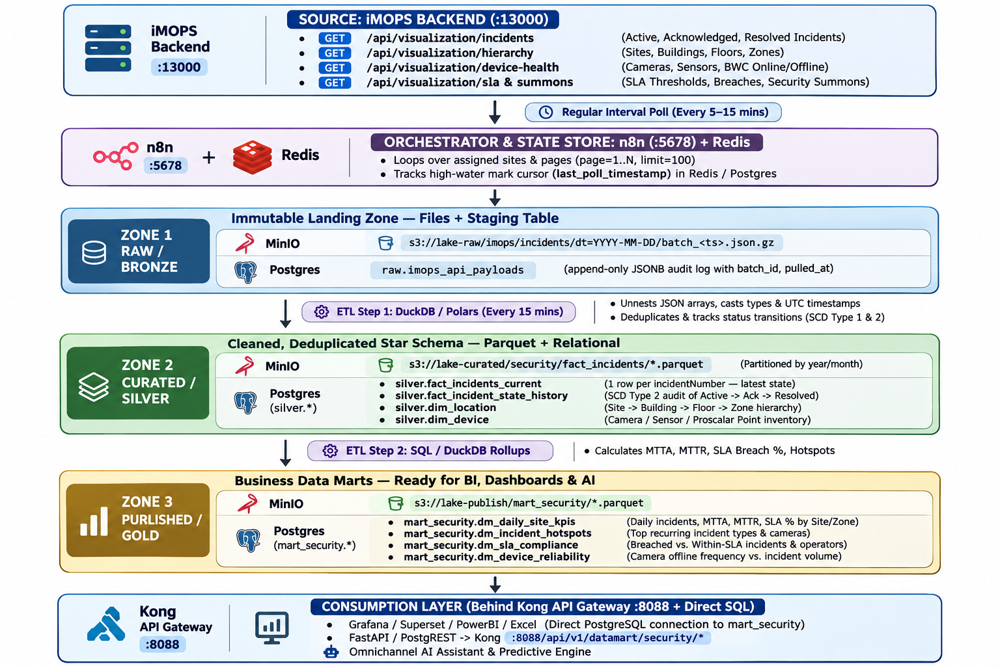

# CDE Security Incident Data Mart — Architecture, Data Model & Gap Analysis

> **Objective:** Extract security-related incident data from **iMOPS** at regular intervals, persist it through a **Medallion Lakehouse + Relational Data Mart (`Raw` $\rightarrow$ `Curated` $\rightarrow$ `Published`)**, and expose curated analytical Data Marts for BI reporting, SLA auditing, Digital Twins, and AI Assistants.

---

## 1. End-to-End Architecture (`Raw` $\rightarrow$ `Curated` $\rightarrow$ `Published`)

To get the best of both worlds—**immutable file archival (Parquet/JSONL)** and **fast SQL query performance for BI/Dashboards (PostgreSQL)**—we combine **MinIO Object Storage** (Files) with **PostgreSQL + DuckDB** (Database):



```
 ┌─────────────────────────────────────────────────────────────────────────────────────────┐
 │                           SOURCE: iMOPS BACKEND (:13000)                                │
 │  • GET /api/visualization/incidents      (Active, Acknowledged, Resolved Incidents)     │
 │  • GET /api/visualization/hierarchy      (Sites, Buildings, Floors, Zones)              │
 │  • GET /api/visualization/device-health  (Cameras, Sensors, BWC Online/Offline)         │
 │  • GET /api/visualization/sla & summons  (SLA Thresholds, Breaches, Security Summons)   │
 └───────────────────────────────────────────┬─────────────────────────────────────────────┘
                                             │
                                             ▼  Regular Interval Poll (Every 5–15 mins)
 ┌─────────────────────────────────────────────────────────────────────────────────────────┐
 │                     ORCHESTRATOR & STATE STORE: n8n (:5678) + Redis                     │
 │  • Loops over assigned sites & pages (page=1..N, limit=100)                             │
 │  • Tracks high-water mark cursor (last_poll_timestamp) in Redis / Postgres              │
 └───────────────────────────────────────────┬─────────────────────────────────────────────┘
                                             │
                                             ▼
 ═══════════════════════════════════════════════════════════════════════════════════════════
   ZONE 1: RAW / BRONZE (Immutable Landing Zone — Files + Staging Table)
 ═══════════════════════════════════════════════════════════════════════════════════════════
   🪣 MinIO: s3://lake-raw/imops/incidents/dt=YYYY-MM-DD/batch_<ts>.json.gz
   🗄️ Postgres: raw.imops_api_payloads (append-only JSONB audit log with batch_id, pulled_at)
                                             │
                                             ▼  ETL Step 1: DuckDB / Polars (Every 15 mins)
                                             │  • Unnests JSON arrays, casts types & UTC timestamps
                                             │  • Deduplicates & tracks status transitions (SCD Type 1 & 2)
 ═══════════════════════════════════════════════════════════════════════════════════════════
   ZONE 2: CURATED / SILVER (Cleaned, Deduplicated Star Schema — Parquet + Relational)
 ═══════════════════════════════════════════════════════════════════════════════════════════
   🪣 MinIO: s3://lake-curated/security/fact_incidents/*.parquet (Partitioned by year/month)
   🗄️ Postgres (silver.*):
      • silver.fact_incidents_current        (1 row per incidentNumber — latest state)
      • silver.fact_incident_state_history   (SCD Type 2 audit of Active -> Ack -> Resolved)
      • silver.dim_location                  (Site -> Building -> Floor -> Zone hierarchy)
      • silver.dim_device                    (Camera / Sensor / Proscalar Point inventory)
                                             │
                                             ▼  ETL Step 2: SQL / DuckDB Rollups
                                             │  • Calculates MTTA, MTTR, SLA Breach %, Hotspots
 ═══════════════════════════════════════════════════════════════════════════════════════════
   ZONE 3: PUBLISHED / GOLD (Business Data Marts — Ready for BI, Dashboards & AI)
 ═══════════════════════════════════════════════════════════════════════════════════════════
   🪣 MinIO: s3://lake-publish/mart_security/*.parquet
   🗄️ Postgres (mart_security.*):
      • mart_security.dm_daily_site_kpis     (Daily incidents, MTTA, MTTR, SLA % by Site/Zone)
      • mart_security.dm_incident_hotspots   (Top recurring incident types & cameras)
      • mart_security.dm_sla_compliance      (Breached vs. Within-SLA incidents & operators)
      • mart_security.dm_device_reliability  (Camera offline frequency vs. incident volume)
                                             │
                                             ▼
 ┌─────────────────────────────────────────────────────────────────────────────────────────┐
 │              CONSUMPTION LAYER (Behind Kong API Gateway :8088 + Direct SQL)             │
 │  • Grafana / Superset / PowerBI / Excel (Direct PostgreSQL connection to mart_security) │
 │  • FastAPI / PostgREST -> Kong (:8088/api/v1/datamart/security/*)                       │
 │  • Omnichannel AI Assistant & Predictive Engine                                         │
 └─────────────────────────────────────────────────────────────────────────────────────────┘
```

---

## 2. Recommended Technology Stack (Matching Your Existing Local Environment)

All required images are **already downloaded in your local Docker image cache** (`docker images`), meaning zero external dependency bloat:

| Layer | Technology | Why This Choice for CDE | Local Image Available? |
| :--- | :--- | :--- | :---: |
| **Regular Interval Poller** | **n8n** (`n8n-server:5678`) | Already running; Schedule Trigger + HTTP Request node handles Basic Auth, pagination, and retries. | ✅ Running (`docker.n8n.io/n8nio/n8n:latest`) |
| **Raw File Lake (Bronze/Silver/Gold)** | **MinIO** (`cde-minio:9000`) | S3-compatible object storage for immutable `.json.gz` raw dumps and partitioned `.parquet` files. | ✅ Cached (`cgr.dev/chainguard/minio:latest`) |
| **Relational Data Mart DB** | **PostgreSQL 16** (`cde-datamart-db:5433`) | Best for structured Star Schema (`raw`, `silver`, `mart_security` schemas), indexing, `JSONB`, and direct connections from Grafana, Excel, or PowerBI. | ✅ Cached (`postgres:16-alpine`) |
| **ETL & Transformation Engine** | **Python (Polars / DuckDB)** or **Postgres SQL Procedures** | DuckDB & Polars read/write both MinIO Parquet and PostgreSQL tables in milliseconds; Postgres native SQL (`INSERT ... ON CONFLICT DO UPDATE`) handles upserts cleanly. | ✅ Cached |
| **Egress API & Caching** | **FastAPI / PostgREST + Kong (`:8088`)** | Exposes Gold Data Mart views as REST/CSV endpoints with Kong `key-auth` and `proxy-cache`. | ✅ Running (`kong:3.9`) |

---

## 3. Data Model Design Across the 3 Zones

### 3.1 Raw Zone (`raw` schema & `s3://lake-raw/`)
Stores the exact unmodified JSON response from iMOPS at each polling interval for full replayability and audit compliance.

* **File Path:** `s3://lake-raw/imops/incidents/dt=YYYY-MM-DD/batch_<ts>.json.gz`
* **Database Table (`raw.imops_api_payloads`):**
  | Column | Type | Description |
  | :--- | :--- | :--- |
  | `batch_id` | `UUID PK` | Unique ID for the polling run |
  | `endpoint` | `VARCHAR(120)` | e.g., `/api/visualization/incidents` |
  | `site_name` | `VARCHAR(100)` | Polled site (e.g., `SOV @ 38ALT`, `Taylor's University`, `ISEMS Pte Ltd`) |
  | `pulled_at` | `TIMESTAMPTZ` | Exact UTC timestamp when n8n fetched the batch |
  | `record_count` | `INTEGER` | Number of incident items in `data.items[]` |
  | `raw_payload` | `JSONB` | Complete unmutated JSON response from iMOPS |

---

### 3.2 Curated Zone (`silver` schema & `s3://lake-curated/`) — Star Schema Core
Cleans, normalizes, and deduplicates the raw batches into conformed **Dimension** and **Fact** tables.

#### Dimension 1: `silver.dim_location` (Synced from `/api/visualization/hierarchy`)
* `location_key` (PK, Surrogate Hash of `site + building + floor + zone`)
* `site_id`, `site_name`, `building_id`, `building_name`, `floor_id`, `floor_name`, `zone_id`, `zone_name`

#### Dimension 2: `silver.dim_device` (Synced from `/api/visualization/equipment` & `/device-health`)
* `device_key` (PK), `device_id`, `device_name` (e.g. `bin_centre`, `OT-MAIN GATE`), `device_type` (`CCTV`, `Access Reader`, `BWC`), `location_key`, `current_health_status`

#### Dimension 3: `silver.dim_incident_type`
* `incident_type_key` (PK), `incident_type_code` (e.g. `crowding`, `loitering`, `door_forced_open`, `fire_alarm`), `category` (`Video Analytics`, `Access Control`, `Safety/Fire`, `Device Health`), `default_severity`, `sla_target_minutes`

#### Fact Table 1: `silver.fact_incidents_current` (Upserted by `incident_number`)
Represents the **latest known truth** for every security incident:
| Column | Type | Description |
| :--- | :--- | :--- |
| `incident_number` | `VARCHAR(40) PK` | Natural key from iMOPS (e.g., `INC-2611-00042`) |
| `event_id` | `VARCHAR(64)` | Upstream MongoDB `_id` (`6ae97a213469fe8b8d21b9e9`) |
| `location_key` | `VARCHAR(64) FK` | Links to `silver.dim_location` |
| `device_key` | `VARCHAR(64) FK` | Links to `silver.dim_device` |
| `incident_type` | `VARCHAR(64)` | Normalized type (`Loitering`, `Door Forced Open`, `Device Offline`) |
| `title` | `TEXT` | Incident title / description |
| `severity` | `VARCHAR(20)` | Standardized: `low`, `medium`, `high`, `critical` |
| `status` | `VARCHAR(20)` | Current state: `active`, `attend_now`, `acknowledged`, `resolved` |
| `operator_name` | `VARCHAR(100)` | Operator who acknowledged/resolved |
| `detected_at` | `TIMESTAMPTZ` | When the incident occurred (`detectedAt`) |
| `acknowledged_at` | `TIMESTAMPTZ` | First transition to `acknowledged` |
| `resolved_at` | `TIMESTAMPTZ` | Transition to `resolved` |
| `mtta_seconds` | `INTEGER` | `EXTRACT(EPOCH FROM (acknowledged_at - detected_at))` |
| `mttr_seconds` | `INTEGER` | `EXTRACT(EPOCH FROM (resolved_at - detected_at))` |
| `is_sla_breached` | `BOOLEAN` | True if response/resolution exceeded SLA threshold |
| `source_system` | `VARCHAR(40)` | `imops_va`, `proscalar_n8n`, `sicc_va`, `dors_va` |
| `first_ingested_at` | `TIMESTAMPTZ` | First time seen by CDE poller |
| `last_updated_at` | `TIMESTAMPTZ` | Last time updated by CDE poller |

#### Fact Table 2: `silver.fact_incident_state_history` (SCD Type 2 Audit Log)
* Captures a new row **only when an incident's `status` or `severity` changes** between polling intervals (`old_status` $\rightarrow$ `new_status`, `changed_at`, `operator`).

---

### 3.3 Published Zone (`mart_security` schema & `s3://lake-publish/`) — Business Data Marts
Pre-joined, aggregated tables and views tailored for specific business consumers:

1. **`mart_security.dm_daily_site_kpis` (Executive & Operations Mart)**
   * **Grain:** `incident_date + site_name + floor_name + zone_name + incident_type + severity`
   * **Metrics:** `total_incidents`, `active_count`, `acknowledged_count`, `resolved_count`, `resolution_rate_pct`, `avg_mtta_minutes`, `avg_mttr_minutes`, `p95_mttr_minutes`, `sla_breach_count`.
2. **`mart_security.dm_incident_hotspots` (Spatial & Camera Hotspot Mart)**
   * **Grain:** `site_name + zone_name + device_name + incident_type` (Rolling 7d / 30d)
   * **Metrics:** `incident_count_7d`, `incident_count_30d`, `prev_7d_trend_pct`, `critical_alarm_count`, `false_alarm_rate`.
3. **`mart_security.dm_sla_compliance` (Compliance & Guard Response Mart)**
   * **Grain:** `incident_date + site_name + operator_name + severity`
   * **Metrics:** `incidents_handled`, `within_sla_count`, `breached_sla_count`, `sla_compliance_pct`, `fastest_ack_sec`, `slowest_ack_sec`.
4. **`mart_security.dm_device_reliability` (Camera & Sensor Health vs. Incident Volume Mart)**
   * **Grain:** `incident_date + site_name + device_name + device_type`
   * **Metrics:** `offline_events_count`, `total_downtime_minutes`, `uptime_pct`, `incidents_triggered_count`.

---

## 4. Gap Analysis: What Exists Today vs. What Needs to Be Built

Reviewing your current `c:\Projects\cde` repository against this Data Mart architecture reveals **6 concrete gaps**:

| # | Gap Area | Current State in `c:\Projects\cde` | Impact / Risk | Recommended Fix |
| :- | :--- | :--- | :--- | :--- |
| **1** | **No Data Mart Storage Containers Deployed** | `MinIO` and `PostgreSQL` are described in `readme.md` and `development_plan.md`, but only `kong-db` (for Kong internal state) is running. There is no `datamart/` stack yet. | Nowhere to persist `raw` $\rightarrow$ `curated` $\rightarrow$ `published` files or tables. | Create `datamart/docker-compose.yml` running **`cde-datamart-db`** (`postgres:16-alpine` on `:5433`) and **`cde-minio`** (`:9000`/`:9001`). |
| **2** | **Push-Only vs. Scheduled Pull in `n8n`** | `n8n` currently only has `proscalar_ingestion_workflow.json` (which waits for inbound webhooks). There is no scheduled poller fetching from iMOPS `:13000`. | Incidents created directly in iMOPS (like VA camera alerts, BWC, or Device Offline) never enter CDE storage. | Build an **n8n Scheduled Poller Workflow** (runs every 5–15 mins) that pulls `/api/visualization/incidents`, `/hierarchy`, and `/sla`. |
| **3** | **iMOPS Pagination & Delta Watermarking** | `/api/visualization/incidents` uses `daysBack`, `page`, and `limit` (not a strict `updated_since` cursor). | Polling without pagination misses records past page 1; polling without deduplication duplicates active incidents every 5 minutes. | Have the poller iterate pages (`daysBack=7&page=1..N&limit=100`), dump raw JSON to Bronze, and use `ON CONFLICT (incident_number) DO UPDATE` in Silver. |
| **4** | **Stateful Incident Lifecycle (MTTA / MTTR)** | Existing Phase 5 SQL in `development_plan.md` treats events as immutable sensor readings (`OVERWRITE_OR_IGNORE`). | Security incidents mutate over time (`active` $\rightarrow$ `acknowledged` $\rightarrow$ `resolved`). Append-only logic cannot compute resolution time or SLA breaches. | Track `first_seen_at`, `acknowledged_at`, and `resolved_at` in `silver.fact_incidents_current` and log transitions in `silver.fact_incident_state_history`. |
| **5** | **Multi-Source Schema Fragmentation** | Incident payloads differ across **Proscalar** (`eventCode: "5002"`), **SICC/DORS VA** (`/va/sov-38alt-...`), and **iMOPS Native** (`INC-2611-00042`). | Reporting queries break if severity (`CRITICAL` vs `critical`) or incident types aren't standardized. | Enforce a canonical mapping table in the Silver ETL step so all sources share unified `severity`, `status`, and `incident_type` taxonomies. |
| **6** | **Visualization & Export Integration** | Grafana currently only queries Prometheus time-series metrics (`:9090`), not business Data Mart tables. | Stakeholders cannot export incident summary tables or SLA reports from Grafana. | Add `cde-datamart-db` as a **PostgreSQL Datasource** in Grafana (`grafana/provisioning/datasources/`) so Grafana can query and export `mart_security.*` directly to CSV! |

---

## 5. 4-Phase Implementation Plan (Ready-to-Execute Blueprint)

Below is the step-by-step implementation blueprint for building and launching the Data Mart stack when ready.

### Target Directory Layout (`c:\Projects\cde\datamart\`)

```
datamart/
├── docker-compose.yml                  # PostgreSQL 16 (cde-datamart-db) + MinIO (cde-minio) + ETL Service
├── .env.example                        # Credentials & polling interval config
├── readme.md                           # Quickstart & verification runbook
├── sql/
│   ├── 01_init_schemas_and_tables.sql  # DDL for raw.*, silver.*, and mart_security.*
│   └── 02_refresh_datamarts.sql        # Stored procedure to recompute Silver -> Gold rollups
├── etl/
│   └── imops_datamart_etl.js           # Poller + Bronze/Silver/Gold ETL + REST/CSV Serving API
└── scripts/
    ├── deploy_datamart.ps1             # One-click deployment script (PowerShell)
    ├── enable_kong_datamart.ps1        # Registers /api/v1/datamart/security/* on Kong (:8088)
    └── verify_datamart.ps1             # Verifies row counts across Raw, Silver, and Gold
```

---

### Phase 1: Deploy the Data Mart Storage Stack (`datamart/`)

#### 1.1 `datamart/docker-compose.yml`
Uses locally cached images (`postgres:16-alpine` and `cgr.dev/chainguard/minio:latest`):

```yaml
services:
  datamart-db:
    image: postgres:16-alpine
    container_name: cde-datamart-db
    restart: unless-stopped
    environment:
      POSTGRES_DB: cde_datamart
      POSTGRES_USER: cdeadmin
      POSTGRES_PASSWORD: cdepassword123
    ports:
      - "5433:5432"
    volumes:
      - datamart_pgdata:/var/lib/postgresql/data
      - ./sql:/docker-entrypoint-initdb.d:ro
    healthcheck:
      test: ["CMD-SHELL", "pg_isready -U cdeadmin -d cde_datamart"]
      interval: 5s
      timeout: 5s
      retries: 5
    networks:
      - cde-network

  minio:
    image: cgr.dev/chainguard/minio:latest
    container_name: cde-minio
    restart: unless-stopped
    command: ["server", "/data", "--console-address", ":9001"]
    environment:
      MINIO_ROOT_USER: cdeadmin
      MINIO_ROOT_PASSWORD: cdepassword123
    ports:
      - "9000:9000"
      - "9001:9001"
    volumes:
      - datamart_minio:/data
    networks:
      - cde-network

volumes:
  datamart_pgdata:
  datamart_minio:

networks:
  cde-network:
    name: cde-network
    external: true
```

#### 1.2 Database Initialization DDL (`datamart/sql/01_init_schemas_and_tables.sql`)

```sql
-- Create the 3 Medallion Zones
CREATE SCHEMA IF NOT EXISTS raw;
CREATE SCHEMA IF NOT EXISTS silver;
CREATE SCHEMA IF NOT EXISTS mart_security;

-- ============================================================================
-- ZONE 1: RAW (BRONZE)
-- ============================================================================
CREATE TABLE IF NOT EXISTS raw.imops_api_payloads (
    batch_id       UUID PRIMARY KEY DEFAULT gen_random_uuid(),
    endpoint       VARCHAR(120) NOT NULL,
    site_name      VARCHAR(100),
    pulled_at      TIMESTAMPTZ NOT NULL DEFAULT NOW(),
    record_count   INTEGER NOT NULL DEFAULT 0,
    s3_object_key  TEXT,
    raw_payload    JSONB NOT NULL
);

CREATE TABLE IF NOT EXISTS raw.etl_watermarks (
    source_name          VARCHAR(80) PRIMARY KEY,
    last_polled_at       TIMESTAMPTZ NOT NULL,
    last_status          VARCHAR(20) NOT NULL DEFAULT 'SUCCESS',
    records_processed    INTEGER NOT NULL DEFAULT 0
);

-- ============================================================================
-- ZONE 2: CURATED (SILVER — STAR SCHEMA)
-- ============================================================================
CREATE TABLE IF NOT EXISTS silver.dim_location (
    location_key   VARCHAR(64) PRIMARY KEY,
    site_id        VARCHAR(64),
    site_name      VARCHAR(120) NOT NULL,
    building_id    VARCHAR(64),
    building_name  VARCHAR(120),
    floor_id       VARCHAR(64),
    floor_name     VARCHAR(120),
    zone_id        VARCHAR(64),
    zone_name      VARCHAR(120),
    updated_at     TIMESTAMPTZ NOT NULL DEFAULT NOW()
);

CREATE TABLE IF NOT EXISTS silver.dim_device (
    device_key             VARCHAR(64) PRIMARY KEY,
    device_id              VARCHAR(64),
    device_name            VARCHAR(120) NOT NULL,
    device_type            VARCHAR(60) DEFAULT 'CCTV',
    location_key           VARCHAR(64) REFERENCES silver.dim_location(location_key),
    current_health_status  VARCHAR(40) DEFAULT 'online',
    updated_at             TIMESTAMPTZ NOT NULL DEFAULT NOW()
);

CREATE TABLE IF NOT EXISTS silver.fact_incidents_current (
    incident_number    VARCHAR(50) PRIMARY KEY,
    event_id           VARCHAR(64),
    location_key       VARCHAR(64) REFERENCES silver.dim_location(location_key),
    device_key         VARCHAR(64) REFERENCES silver.dim_device(device_key),
    site_name          VARCHAR(120),
    building_name      VARCHAR(120),
    floor_name         VARCHAR(120),
    zone_name          VARCHAR(120),
    device_name        VARCHAR(120),
    incident_type      VARCHAR(80) NOT NULL,
    title              TEXT,
    severity           VARCHAR(20) NOT NULL DEFAULT 'medium',
    status             VARCHAR(30) NOT NULL DEFAULT 'active',
    operator_name      VARCHAR(100),
    detected_at        TIMESTAMPTZ NOT NULL,
    acknowledged_at    TIMESTAMPTZ,
    resolved_at        TIMESTAMPTZ,
    mtta_seconds       INTEGER,
    mttr_seconds       INTEGER,
    is_sla_breached    BOOLEAN DEFAULT FALSE,
    source_system      VARCHAR(40) DEFAULT 'imops',
    first_ingested_at  TIMESTAMPTZ NOT NULL DEFAULT NOW(),
    last_updated_at    TIMESTAMPTZ NOT NULL DEFAULT NOW()
);

CREATE TABLE IF NOT EXISTS silver.fact_incident_state_history (
    history_id         BIGSERIAL PRIMARY KEY,
    incident_number    VARCHAR(50) NOT NULL,
    old_status         VARCHAR(30),
    new_status         VARCHAR(30) NOT NULL,
    severity           VARCHAR(20),
    operator_name      VARCHAR(100),
    changed_at         TIMESTAMPTZ NOT NULL DEFAULT NOW()
);

-- ============================================================================
-- ZONE 3: PUBLISHED (GOLD — BUSINESS DATA MARTS)
-- ============================================================================
CREATE TABLE IF NOT EXISTS mart_security.dm_daily_site_kpis (
    incident_date        DATE NOT NULL,
    site_name            VARCHAR(120) NOT NULL,
    floor_name           VARCHAR(120) NOT NULL DEFAULT 'All',
    zone_name            VARCHAR(120) NOT NULL DEFAULT 'All',
    incident_type        VARCHAR(80) NOT NULL,
    severity             VARCHAR(20) NOT NULL,
    total_incidents      INTEGER NOT NULL DEFAULT 0,
    active_count         INTEGER NOT NULL DEFAULT 0,
    acknowledged_count   INTEGER NOT NULL DEFAULT 0,
    resolved_count       INTEGER NOT NULL DEFAULT 0,
    resolution_rate_pct  NUMERIC(5,2) DEFAULT 0,
    avg_mtta_minutes     NUMERIC(10,2),
    avg_mttr_minutes     NUMERIC(10,2),
    sla_breach_count     INTEGER NOT NULL DEFAULT 0,
    refreshed_at         TIMESTAMPTZ NOT NULL DEFAULT NOW(),
    PRIMARY KEY (incident_date, site_name, floor_name, zone_name, incident_type, severity)
);

CREATE TABLE IF NOT EXISTS mart_security.dm_incident_hotspots (
    site_name            VARCHAR(120) NOT NULL,
    zone_name            VARCHAR(120) NOT NULL,
    device_name          VARCHAR(120) NOT NULL,
    incident_type        VARCHAR(80) NOT NULL,
    incident_count_7d    INTEGER NOT NULL DEFAULT 0,
    incident_count_30d   INTEGER NOT NULL DEFAULT 0,
    critical_alarm_count INTEGER NOT NULL DEFAULT 0,
    last_incident_at     TIMESTAMPTZ,
    refreshed_at         TIMESTAMPTZ NOT NULL DEFAULT NOW(),
    PRIMARY KEY (site_name, zone_name, device_name, incident_type)
);

CREATE TABLE IF NOT EXISTS mart_security.dm_sla_compliance (
    incident_date        DATE NOT NULL,
    site_name            VARCHAR(120) NOT NULL,
    operator_name        VARCHAR(100) NOT NULL DEFAULT 'Unassigned',
    severity             VARCHAR(20) NOT NULL,
    incidents_handled    INTEGER NOT NULL DEFAULT 0,
    within_sla_count     INTEGER NOT NULL DEFAULT 0,
    breached_sla_count   INTEGER NOT NULL DEFAULT 0,
    sla_compliance_pct   NUMERIC(5,2) DEFAULT 100.0,
    fastest_ack_sec      INTEGER,
    slowest_ack_sec      INTEGER,
    refreshed_at         TIMESTAMPTZ NOT NULL DEFAULT NOW(),
    PRIMARY KEY (incident_date, site_name, operator_name, severity)
);

CREATE TABLE IF NOT EXISTS mart_security.dm_device_reliability (
    incident_date              DATE NOT NULL,
    site_name                  VARCHAR(120) NOT NULL,
    device_name                VARCHAR(120) NOT NULL,
    device_type                VARCHAR(60) NOT NULL DEFAULT 'CCTV',
    offline_events_count       INTEGER NOT NULL DEFAULT 0,
    incidents_triggered_count  INTEGER NOT NULL DEFAULT 0,
    current_health_status      VARCHAR(40) DEFAULT 'online',
    refreshed_at               TIMESTAMPTZ NOT NULL DEFAULT NOW(),
    PRIMARY KEY (incident_date, site_name, device_name)
);
```

---

### Phase 2: Build the Automated Poller & Medallion ETL Pipeline

The ETL runner executes every **5–15 minutes** (via `cde-datamart-etl` container or `n8n` Schedule Trigger):

1. **Extract (Poll iMOPS `:13000`):**
   - Calls `GET /api/visualization/hierarchy` to sync sites, buildings, floors, and zones.
   - Calls `GET /api/visualization/incidents?daysBack=7&page=1..N&limit=100` (iterating pages until all items are retrieved).
   - Calls `GET /api/visualization/device-health` and `GET /api/visualization/sla`.
2. **Load Bronze (`raw`):**
   - Compresses the raw JSON response and uploads `s3://lake-raw/imops/incidents/dt=YYYY-MM-DD/batch_<ts>.json.gz` to `cde-minio`.
   - Inserts a row into `raw.imops_api_payloads`.
3. **Transform Silver (`silver`):**
   - Upserts `silver.dim_location` and `silver.dim_device`.
   - Upserts each incident into `silver.fact_incidents_current` (`ON CONFLICT (incident_number) DO UPDATE`):
     - If `NEW.status = 'acknowledged'` and `OLD.acknowledged_at IS NULL`, sets `acknowledged_at = NOW()` and computes `mtta_seconds`.
     - If `NEW.status = 'resolved'` and `OLD.resolved_at IS NULL`, sets `resolved_at = NOW()` and computes `mttr_seconds`.
     - If `NEW.status <> OLD.status`, inserts a state transition record into `silver.fact_incident_state_history`.
   - Writes a partitioned `.parquet` snapshot to `s3://lake-curated/security/fact_incidents/`.
4. **Refresh Gold (`mart_security`):**
   - Runs the Gold aggregation query (`02_refresh_datamarts.sql`) to populate `dm_daily_site_kpis`, `dm_incident_hotspots`, `dm_sla_compliance`, and `dm_device_reliability`, and exports Gold Parquet snapshots to `s3://lake-publish/mart_security/`.

---

### Phase 3: Expose the Published Data Mart via Kong API Gateway (`:8088`)

1. **Data Mart Serving Endpoints (JSON & CSV Support):**
   - `GET /api/v1/datamart/security/daily-kpis?site=<site>&format=json|csv`
   - `GET /api/v1/datamart/security/hotspots?format=json|csv`
   - `GET /api/v1/datamart/security/sla-compliance?format=json|csv`
   - `GET /api/v1/datamart/security/device-reliability?format=json|csv`
   - `GET /api/v1/datamart/security/incidents?status=active&format=json|csv`
2. **Register Service & Route on Kong Gateway (`:8001`):**
   ```powershell
   # 1. Create Kong Service pointing to the Data Mart Serving API
   curl.exe -X POST http://localhost:8001/services `
     -d "name=cde-security-datamart-service" `
     -d "url=http://cde-datamart-etl:8090"

   # 2. Create Kong Route (/api/v1/datamart/security)
   curl.exe -X POST http://localhost:8001/services/cde-security-datamart-service/routes `
     -d "name=security-datamart-route" `
     -d "paths[]=/api/v1/datamart/security" `
     -d "strip_path=false"
   ```

---

### Phase 4: Connect Grafana (`:3000`) for BI Dashboards & 1-Click CSV Export

1. **Add PostgreSQL Datasource in `grafana/provisioning/datasources/datasources.yaml`:**
   ```yaml
   - name: CDE Security Data Mart
     type: postgres
     uid: CDESecurityDataMart
     url: cde-datamart-db:5432
     user: cdeadmin
     secureJsonData:
       password: cdepassword123
     jsonData:
       database: cde_datamart
       sslmode: disable
       postgresVersion: 1600
   ```
2. **Provision the Grafana Security Incident Data Mart Dashboard:**
   - Displays **Daily Incidents by Site & Severity**, **MTTA / MTTR Trend**, **SLA Compliance %**, **Top Camera/Zone Hotspots**, and a full **Security Incidents Table** where any user can click **`⋮` $\rightarrow$ Inspect $\rightarrow$ Data $\rightarrow$ Download CSV**.

---

## 10. Operations Runbook: Startup Commands, Service URLs & Implementation Status

### 10.1 Current Implementation Progress

| Phase | Scope | Status |
| :--- | :--- | :--- |
| **Phase 1** | **Storage & Medallion Schema Initialization** (`cde-datamart-db` on `:5433`, `cde-minio` on `:9000/:9001`, 12 tables across `raw`, `silver`, `mart_security`, S3 buckets `lake-raw`, `lake-curated`, `lake-publish`) | **Completed & Verified** |
| **Phase 2** | **Hybrid n8n Scheduled Poller + Medallion ETL & Serving API** (`n8n` workflow `CdeImopsDataMart1` triggering `cde-datamart-etl` on `:8090` every 5 mins) | **Completed & Verified** |
| **Phase 3** | **Data Catalogue, Self-Service API Key Portal (`/catalog`) & Kong API Gateway (`:8088`) Egress** (`key-auth` protection + Gold-only publishing) | **Completed & Verified** |
| **Phase 4** | **Connect Grafana (`:3000`) to `cde-datamart-db` & Provision Security Data Mart Dashboard** (`http://localhost:3000/d/cde-security-datamart`) | **Completed & Verified** |

---

### 10.2 Complete Service URLs & Credentials Reference

| Layer | Service / Container | URL / Host Port | Credentials & Notes |
| :--- | :--- | :--- | :--- |
| **n8n Orchestrator (Control Plane)** | `n8n-server` / `n8n-proxy` | **[https://localhost:5678](https://localhost:5678)** | Active workflow: **`iMOPS Security Incident Poller & Medallion Data Mart ETL`** (`ID: CdeImopsDataMart1`) |
| **n8n Poller Workflow Canvas** | `n8n-server` | **[https://localhost:5678/workflow/CdeImopsDataMart1](https://localhost:5678/workflow/CdeImopsDataMart1)** | Visual 5-minute `Schedule Trigger` + 5-step Medallion pipeline |
| **n8n Poller Executions UI** | `n8n-server` | **[https://localhost:5678/workflow/CdeImopsDataMart1/executions](https://localhost:5678/workflow/CdeImopsDataMart1/executions)** | Inspect every 5-minute scheduled run and node JSON outputs |
| **Data Mart ETL & Serving API** | `cde-datamart-etl` | **[http://localhost:8090/api/v1/datamart/security/summary](http://localhost:8090/api/v1/datamart/security/summary)** | Health check: **[http://localhost:8090/api/v1/datamart/security/health](http://localhost:8090/api/v1/datamart/security/health)** |
| **MinIO S3 Web Console** | `cde-minio` | **[http://localhost:9001](http://localhost:9001)** | Login: `cdeadmin` / `cdepassword123` (`lake-raw`, `lake-curated`, `lake-publish`) |
| **MinIO S3 API** | `cde-minio` | `http://localhost:9000` | Internal Docker alias: `http://cde-minio:9000` |
| **PostgreSQL 16 Data Mart** | `cde-datamart-db` | `localhost:5433` (Internal: `cde-datamart-db:5432`) | DB: `cde_datamart` / User: `cdeadmin` / Pass: `cdepassword123` |
| **iMOPS Source Backend** | `imops-backend` | `http://localhost:13000` | Basic Auth: `dors_user@isems.com` / `1Pu1znaPbTqXcyC5KVpP` |
| **Kong API Gateway** | `kong-gateway` | `http://localhost:8088` | Admin API: `http://localhost:8001` / Kong Manager UI: **[http://localhost:8002](http://localhost:8002)** |
| **Grafana BI Dashboards** | `cde-grafana` | **[http://localhost:3000](http://localhost:3000)** | Login: `admin` / `admin123` |
| **Kibana (ELK Logs)** | `cde-kibana` | **[http://localhost:5601](http://localhost:5601)** | Dashboard: **[CDE Platform Overview](http://localhost:5601/app/dashboards#/view/cde-platform-overview)** |

---

### 10.3 Commands to Start / Resume All CDE Stacks

```powershell
# 1. Start Data Mart Stack (Postgres :5433, MinIO :9000/:9001, ETL API :8090)
docker compose -f c:\Projects\cde\datamart\docker-compose.yml up -d

# 2. Start n8n Orchestrator (:5678)
docker compose -f c:\Projects\cde\n8n\docker-compose.yml up -d

# 3. Start Kong API Gateway (:8088 / Admin :8001 / Manager :8002) — Required for Phase 3
docker compose -f c:\Projects\cde\apigw\docker-compose.yml up -d

# 4. Start Prometheus & Grafana (:3000) — Required for Phase 4
docker compose -f c:\Projects\cde\grafana\docker-compose.yml up -d

# 5. (Optional) Start ELK Log Stack (Kibana :5601)
docker compose -f c:\Projects\cde\elk\docker-compose.yml up -d
```

---

### 10.4 Verification & Diagnostic Commands

```powershell
# 1. Run full Data Mart verification script (checks containers, 11 tables, 3 S3 buckets & row counts)
powershell -ExecutionPolicy Bypass -File c:\Projects\cde\datamart\scripts\verify_datamart.ps1

# 2. Check ETL Health, Watermarks & Last Run Result
Invoke-RestMethod -Uri "http://localhost:8090/api/v1/datamart/security/health" | ConvertTo-Json -Depth 5

# 3. Trigger an Immediate Poll via n8n Webhook
curl.exe -k -X POST "https://localhost:5678/webhook/datamart-sync"

# 4. Stream Live ETL Container Logs
docker logs -f cde-datamart-etl

# 5. Inspect Raw Batch Audit Trail in PostgreSQL
docker exec cde-datamart-db psql -U cdeadmin -d cde_datamart -c "SELECT pulled_at, endpoint, site_name, record_count, s3_object_key FROM raw.imops_api_payloads ORDER BY pulled_at DESC LIMIT 16;"
```

