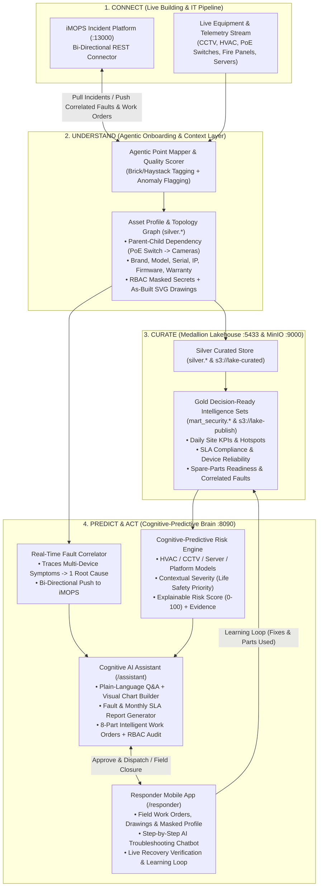

# `dat-shift AI` — Cognitive-Predictive AI Platform Specification & Implementation Plan

---

## Part I: Product Vision & Functional Requirements

### 1. Objective
We will rename **CDE** to **`dat-shift AI`** and implement **Predictive and Cognitive AI capabilities** across the platform.

> **The cognitive-predictive AI platform for critical buildings and command centers.**  
> `dat-shift AI` does more than predict faults. It understands the environment around every asset, correlates alarms, history, and conditions, and judges which risks truly matter and why. AI agents then explain, act, and help fix them—with people in control.

### 2. How It Works (The 4-Stage Intelligence Pipeline)
1. **Connect:** Collects live data from building and IT systems across every site through one secure, on-premise pipeline.
2. **Understand (Agentic AI Layer):** AI agents work on the cleansed data—recognising equipment and points, mapping them to industry standards (e.g., Brick Schema / Project Haystack), enriching them with site and asset context, and flagging data quality issues. Onboarding a new building takes days, not months.
3. **Curate:** Agents publish decision-ready intelligence sets—such as **asset health**, **alarm patterns**, **fault response performance**, and **spare-parts readiness**—tailored to each use case.
4. **Predict & Act:** Predictive models and AI agents turn that intelligence into early warnings, explained recommendations, and approved fixes.

### 3. Cognitive-Predictive AI (Signature Feature)
* **Goes Beyond Prediction:** Forecasts likely faults, then correlates them with the surrounding environment—including recent alarms, maintenance history, weather, occupancy, related equipment, and what the asset serves.
* **Contextual Severity & Operational Impact:** Evaluates the contextual severity and operational impact of each risk with the reasoning behind it, so faults affecting **mission-critical** or **life-safety** systems are always prioritised above minor ones.
* **Pre-Trained Domain-Specific Model Library:** Pre-configured models for **HVAC**, **CCTV**, **Servers**, and **Integration Platforms**.
* **Day-One + Adaptive Models:** Generic models that work from day one, plus per-site learning of normal behaviour.
* **Explainable Risk Scores:** Context-aware risk scores (`0–100`) with the explicit reasons and evidence behind them.

### 4. Real-Time Fault Detection & Correlation
* **Bi-Directional Incident Management Integration:** Integrates natively with the customer's existing incident management platform (**iMOPS** on `:13000`), forwarding fault alerts that need an incident response through API-based, bi-directional connectors. `dat-shift AI` is not another incident management system; it adds intelligence to the one already in place.
* **Dedicated Fast-Path Fault Detection:** Equipment faults and abnormal conditions are detected in real time from live device data and raised as fault alerts within seconds on a dedicated path independent of batch analytics.
* **Topological Root-Cause Correlation:** Fault correlation traces related symptoms to a single root cause—for example, several **CCTV cameras going offline at the same time**, traced to the **PoE switch** that powers them—and raises **one enriched fault record** with probable cause, priority, and recommended actions attached.
* **Frictionless Integration:** Open APIs, webhooks, and standard connectors with no change to operators' existing workflows.

### 5. Cognitive AI Assistant
* **Plain-Language Risk Explanation:** Explains risks in plain language with cited evidence and priority.
* **Natural Language Operational Q&A:** Answers operator questions (e.g., *"Which sites had repeated fire panel faults this month?"*).
* **Automated Executive Reporting:** Drafts fault summary reports and monthly SLA compliance reports.
* **On-Demand Visual Report & Chart Generator:** Users ask in plain language (e.g., *"Show chiller or camera health across all sites this quarter"*), and the AI builds interactive charts and dashboard-style views ready to refine, share, or export (CSV/PDF).
* **8-Part Intelligent Work Orders** (sent once approved to the maintenance team or MMS/iMOPS):
  1. **Right Responder:** Assesses fault type, asset, location, criticality, service contracts, and on-duty rosters to assign the right stakeholder (in-house technician, OEM vendor, IT team, or fire contractor), with escalation if unacknowledged.
  2. **Affected Device Profile (with RBAC Secret Masking):** Automatically pulls the faulty device's details in real time—brand, model, serial number, firmware version, IP address, network switch/port location, current configuration, warranty, and service history. **Access is role-based:** passwords, keys, and secrets are masked (`••••••••`), sensitive configuration is shown only to authorised roles (`ADMIN` / `SENIOR_ENGINEER`), and **every reveal/view is audit-logged**.
  3. **Working Drawings:** Attaches the relevant as-built drawings for the affected system—floor plan layouts showing device location, schematic and single-line diagrams, and wiring/network topology drawings—so the technician can locate the device and trace the system quickly.
  4. **Diagnosis & Evidence:** Likely root cause, confidence level (`%`), supporting telemetry/alarm trends, and correlated child/parent alarms.
  5. **Recommended Preparation:** Required spare parts (checked against spare-parts readiness inventory), tools, access permits, safety precautions, and isolation/LOTO steps to arrange before arriving on site.
  6. **Suggested Troubleshooting Steps:** Step-by-step interactive checklist drawn from runbooks, OEM manuals, and past fixes for similar faults.
  7. **Closure Criteria:** Objective verification criteria to confirm the fix (e.g., device heartbeat restored, readings back in range, alarms cleared), with the AI verifying live recovery before the work order is closed.
  8. **Learning Loop:** Captures what was actually done in the field (root cause confirmed, steps taken, parts consumed) to improve future recommendations.

### 6. Responder Mobile App
* **Field Technician Companion:** Mobile-optimised Progressive Web App (PWA) giving field responders the assigned work order, device profile, interactive working drawings, and troubleshooting checklist on site.
* **AI-Assisted Troubleshooting Chatbot:** Responders describe what they see on site, and the AI guides them step by step using live readings, alarm history, manuals, runbooks, and past fixes.
* **Live Equipment Recovery Check:** Displays real-time status/heartbeat of the affected equipment so responders can confirm immediately whether each troubleshooting step worked.
* **Field Updates & Learning Loop:** Responders update the work order from the field with notes, photos, and parts used—automatically feeding the fault lifecycle KPIs and the cognitive learning loop.
* **Unified RBAC & Secret Masking:** Enforces the exact same role-based masking and audit logging of sensitive device configuration as the main platform.

### 7. Conceptual Foundation: Predictive vs. Cognitive Systems

| Dimension | Predictive Systems: *"What is likely to happen?"* | Cognitive Systems: *"What does this mean, and what should be done?"* |
| :--- | :--- | :--- |
| **Core Function** | Extrapolates historical patterns into future failure probabilities, MTBF degradation, and risk scores. | Understands intent, topological context, and unstructured runbooks to synthesize root causes and orchestrate multi-step actions. |
| **Data Input** | Structured/semi-structured numerical & categorical data (sensor telemetry, incident timestamps, SLA timers, device health counters). | Unstructured & graph data (alarm floods, network/power topology graphs, maintenance manuals, as-built drawings, technician field notes). |
| **Logic Paradigm** | **Deterministic / Statistical:** Given input features $X$, computes failure probability $P(\text{fault})$ and anomaly score $Z$. | **Adaptive / Agentic:** Reasons across asset relationships, explains rationale in plain language, generates work orders, and learns from field closure feedback. |
| **Key Applications in `dat-shift AI`** | • Equipment failure forecasting (Weibull / Poisson rate acceleration) • SLA breach probability prediction • Spare-parts demand forecasting | • Root-cause correlation (e.g., 4 cameras offline $\rightarrow$ 1 PoE switch fault) • NL2SQL & dynamic visual chart generation • 8-part Intelligent Work Order & Field Troubleshooting Copilot |

---

## Part II: Feasibility & Gap Analysis Against Existing Infrastructure

### 1. Feasibility Summary

| Architectural Layer | Current State in Workspace (`c:\Projects\cde`) | Feasibility | Required Upgrade for `dat-shift AI` |
| :--- | :--- | :---: | :--- |
| **1. Connect (Ingestion & Gateway)** | • `n8n` (`:5678`) 5-min poller + webhook ingress • `kong-gateway` (`:8088`) with `key-auth` | **100% Ready** | Add fast-path real-time fault webhook (`POST /api/v1/datamart/security/faults/ingest`) + bi-directional connector to iMOPS (`:13000`). |
| **2. Understand (Agentic Onboarding & Topology)** | • Silver ETL normalizes `dim_location`, `dim_device`, `dim_operator` | **85% Ready** | Add **Standard Point Mapping** (Brick/Haystack tags), **Data Quality Score**, **Asset Profile Registry** (IP, serial, firmware, warranty, RBAC secrets), and **Parent-Child Topology Graph** (`PoE Switch` $\rightarrow$ `CCTV`). |
| **3. Curate (Medallion Lakehouse)** | • PostgreSQL (`:5433`) `raw`, `silver`, `mart_security` • MinIO (`:9000`) `lake-raw`, `lake-curated`, `lake-publish` | **95% Ready** | Add new Gold intelligence tables: **`dm_asset_health`**, **`dm_spare_parts_readiness`**, **`dm_predictive_risk_scores`**, and **`dm_correlated_faults`**. |
| **4. Predict (Domain Models & Contextual Risk)** | • Historical incident counts, MTTA/MTTR, and hotspot views exist | **85% Ready** | Implement the **Domain Model Library** (HVAC, CCTV, Servers, Integration) + **Contextual Risk Engine** combining failure probability, asset criticality (`LIFE_SAFETY` vs. `STANDARD`), weather/occupancy context, and explainable evidence. |
| **5. Act (Cognitive Assistant, Work Orders & Mobile App)** | • Gold Explorer (`:8090`), Data Catalogue (`:8090/catalog`), Grafana (`:3000`) | **85% Ready** | Build **`/assistant`** (NL2SQL Q&A, Dynamic Chart Builder, SLA Report Drafter, 8-Part Work Order Generator with SVG Working Drawings & RBAC Secret Masking) and **`/responder`** (Mobile PWA with AI Troubleshooting Chatbot & Learning Loop). |

---

## Part III: Target System Architecture (`dat-shift AI`)

---

## Part IV: New Data Model Extensions (`silver.*` & `mart_security.*`)

To support all requirements in Part I without breaking any existing Gold Data Mart tables, we extend PostgreSQL (`cde-datamart-db` on `:5433`) with the following tables:

### 1. `silver.dim_asset_profile` (Device Profile, Topology & RBAC-Masked Secrets)
Stores enriched equipment metadata, topological parent links (e.g., CCTV Camera $\rightarrow$ PoE Switch), criticality, and masked secrets:
* `device_key` (`INT PK` references `silver.dim_device`)
* `standard_class` (`VARCHAR` — e.g., `brick:Camera`, `brick:PoE_Network_Switch`, `brick:Chiller`, `brick:Fire_Alarm_Control_Panel`, `brick:Server`)
* `domain_category` (`VARCHAR` — `CCTV`, `HVAC`, `SERVER`, `INTEGRATION`, `LIFE_SAFETY`)
* `criticality_tier` (`VARCHAR` — `LIFE_SAFETY`, `MISSION_CRITICAL`, `ESSENTIAL`, `STANDARD`)
* `serves_zone_or_system` (`VARCHAR` — e.g., `"Main Lobby & Turnstiles Security"`, `"Data Center Cooling Loop A"`)
* `parent_device_key` (`INT` — points to upstream switch/panel/controller for root-cause fault correlation)
* `brand`, `model`, `serial_number`, `firmware_version`, `ip_address`, `mac_address`, `network_switch_port`
* `warranty_expiry` (`DATE`), `service_contract_vendor` (`VARCHAR`), `assigned_responder_role` (`VARCHAR`)
* `config_summary_public` (`JSONB` — non-sensitive parameters)
* `config_secrets_encrypted` (`JSONB` — admin passwords, RTSP/SNMP keys, API tokens; **always masked as `••••••••` unless role = `ADMIN` or `SENIOR_ENGINEER`**)
* `data_quality_score` (`NUMERIC(5,2)`), `onboarding_status` (`VARCHAR`)

### 2. `silver.dim_working_drawings` (As-Built Drawings & Schematics)
* `drawing_id` (`SERIAL PK`), `location_key` (`INT`), `device_key` (`INT`)
* `drawing_type` (`VARCHAR` — `FLOOR_PLAN`, `SINGLE_LINE_SCHEMATIC`, `NETWORK_TOPOLOGY`)
* `drawing_title` (`VARCHAR`), `drawing_version` (`VARCHAR`)
* `svg_content` / `s3_drawing_uri` (`TEXT` — interactive SVG showing exact device pin, power/PoE path, and isolation points)

### 3. `mart_security.dm_correlated_faults` (Real-Time Root-Cause Correlation)
* `correlation_id` (`VARCHAR PK` — e.g., `CORR-2026-0001`)
* `detected_at` (`TIMESTAMPTZ`), `site_name` (`VARCHAR`), `zone_name` (`VARCHAR`)
* `root_cause_device_key` (`INT`), `root_cause_device_name` (`VARCHAR`), `root_cause_type` (`VARCHAR`)
* `symptom_device_count` (`INT`), `symptom_devices_json` (`JSONB` — e.g., 4 offline CCTV cameras)
* `probable_cause_summary` (`TEXT` — e.g., *"Upstream PoE Switch SW-POE-01 port bank power fault causing simultaneous drop of 4 downstream CCTV cameras"*)
* `contextual_priority` (`VARCHAR` — `P1_LIFE_SAFETY`, `P1_MISSION_CRITICAL`, `P2_HIGH`, `P3_MEDIUM`)
* `recommended_actions_json` (`JSONB`), `imops_forwarded_status` (`VARCHAR`), `imops_reference_id` (`VARCHAR`)

### 4. `mart_security.dm_predictive_risk_scores` (Cognitive-Predictive Risk Engine)
* `risk_id` (`SERIAL PK`), `device_key` (`INT`), `device_name` (`VARCHAR`), `domain_category` (`VARCHAR`), `site_name` (`VARCHAR`)
* `predicted_fault_type` (`VARCHAR`), `failure_probability_pct` (`NUMERIC(5,2)`), `forecast_horizon_hours` (`INT`)
* `contextual_severity` (`VARCHAR`), `context_risk_score` (`NUMERIC(5,2)` — `0` to `100`)
* `environmental_factors_json` (`JSONB` — weather, occupancy load, recent alarms, maintenance backlog, what the asset serves)
* `reasoning_explanation` (`TEXT` — plain-language explanation of *why* this risk matters and the supporting evidence)
* `model_name` (`VARCHAR` — e.g., `CCTV-PoE-Degradation-v2`, `HVAC-Thermal-Drift-v1`, `FirePanel-Loop-Fault-v1`)

### 5. `mart_security.dm_spare_parts_readiness` (Curated Spare-Parts Intelligence)
* `part_sku` (`VARCHAR PK`), `part_name` (`VARCHAR`), `compatible_domain` (`VARCHAR`), `compatible_models` (`VARCHAR`)
* `stock_on_hand` (`INT`), `reorder_threshold` (`INT`), `predicted_30d_demand` (`INT`)
* `readiness_status` (`VARCHAR` — `READY`, `LOW_STOCK_WARNING`, `CRITICAL_SHORTAGE`), `warehouse_location` (`VARCHAR`)

### 6. `mart_security.intelligent_work_orders` & `mart_security.work_order_learning_loop`
* Stores the complete **8-Part Intelligent Work Order** lifecycle (`DRAFT` $\rightarrow$ `APPROVED` $\rightarrow$ `DISPATCHED` $\rightarrow$ `IN_PROGRESS` $\rightarrow$ `RECOVERY_VERIFIED` $\rightarrow$ `CLOSED`):
  1. `right_responder_json` (assigned stakeholder, team, contract SLA, escalation timer)
  2. `device_profile_snapshot_json` (linked to `dim_asset_profile`)
  3. `working_drawings_json` (linked floor plan & network topology diagrams)
  4. `diagnosis_and_evidence_json` (root cause, confidence `%`, correlated alarms)
  5. `recommended_preparation_json` (spare parts reserved, tools, permits, LOTO isolation steps)
  6. `troubleshooting_checklist_json` (interactive step-by-step runbook items with completion state)
  7. `closure_criteria_json` (automated recovery checks: ping/heartbeat, alarm clear, telemetry range)
  8. `learning_loop_json` (technician field notes, actual fix applied, parts used, photo attachments, model feedback)

### 7. `mart_security.audit_secret_access_log` (RBAC Secret Reveal Audit Trail)
* `audit_id` (`SERIAL PK`), `accessed_at` (`TIMESTAMPTZ`), `user_name` (`VARCHAR`), `user_role` (`VARCHAR`), `device_key` (`INT`), `device_name` (`VARCHAR`), `action` (`VARCHAR`), `access_granted` (`BOOLEAN`), `client_ip` (`VARCHAR`)

---

## Part V: Phased Implementation Plan

### Phase 1: Rebranding to `dat-shift AI` + Stage 2 (`Understand`) & Stage 3 (`Curate`) Extensions
**Goal:** Rebrand the platform to **`dat-shift AI`** and build the Asset Context, Topology Graph, As-Built Drawings, RBAC Secret Masking, and Spare-Parts Readiness tables.
* **Deliverables:**
  1. Extend PostgreSQL schema ([datamart/sql/01_init_schemas_and_tables.sql](file:///c:/Projects/cde/datamart/sql/01_init_schemas_and_tables.sql)) with `silver.dim_asset_profile`, `silver.dim_working_drawings`, `mart_security.dm_spare_parts_readiness`, and `mart_security.audit_secret_access_log`.
  2. Build the **Agentic Onboarding & Point-Mapping Step** in the ETL pipeline: automatically maps every iMOPS device into standard classes (`CCTV`, `HVAC`, `LIFE_SAFETY`, `SERVER`, `INTEGRATION`), assigns upstream parent switches/controllers (`PoE Switch` $\rightarrow$ `CCTV Cameras`), generates interactive SVG floor plans & single-line network topology diagrams, and populates realistic device profiles (brand, model, serial, firmware, IP, warranty, masked credentials).
  3. Implement **RBAC Secret Masking & Audit API** (`GET /api/v1/datamart/security/assets/:id/profile` + `POST /api/v1/datamart/security/assets/:id/reveal-secrets`): masks passwords/keys by default and logs every reveal request to `mart_security.audit_secret_access_log`.
  4. Rebrand web portals (`:8090` and `:8090/catalog`) to **`dat-shift AI — Cognitive-Predictive Building & Command Center Intelligence`**.

---

### Phase 2: Real-Time Fault Correlation & Cognitive-Predictive Risk Engine (`Predict`)
**Goal:** Implement the signature **Cognitive-Predictive AI Engine** and **Real-Time Topological Fault Correlator** with bi-directional iMOPS integration.
* **Deliverables:**
  1. **Real-Time Topological Fault Correlator (`/api/v1/datamart/security/correlate`)**:
     * Detects when multiple child devices (e.g., 3+ CCTV cameras on the same floor/zone) trigger faults within a correlation window, traces them via `parent_device_key` to the shared **PoE Switch / Controller**, suppresses duplicate symptom tickets, and raises **one enriched fault record** in `mart_security.dm_correlated_faults`.
     * Includes a **Bi-Directional iMOPS Connector** that forwards correlated root-cause alerts back to iMOPS (`localhost:13000`).
  2. **Domain-Specific Predictive Model Library (`/api/v1/datamart/security/predict`)**:
     * Runs pre-trained + site-adaptive risk scoring across **CCTV**, **HVAC**, **Life-Safety/Fire Panels**, **Servers**, and **Integration Platforms**.
     * Correlates failure probability with **environmental context** (ambient weather/heatload, building occupancy, recent alarm velocity, maintenance history, and what mission-critical zone the asset serves).
     * Persists explainable risk scores (`0–100`) and plain-language evidence into `mart_security.dm_predictive_risk_scores` and publishes Gold Parquet snapshots to `s3://lake-publish/predictive_risk_scores/`.

---

### Phase 3: Cognitive AI Assistant, Dynamic Visual Report Builder & 8-Part Intelligent Work Orders (`Act`)
**Goal:** Launch the interactive **`dat-shift AI` Cognitive Assistant & Operations Center (`/assistant` on `:8090`)**.
* **Deliverables:**
  1. **Natural Language Q&A & Dynamic Visual Report Generator**:
     * Operators ask questions in plain language (e.g., *"Which sites had repeated fire panel or camera faults this month?"*, *"Show device health and SLA compliance across all sites this quarter"*).
     * The assistant executes safe analytical queries over the Gold Data Mart, answers in plain English with cited evidence, and **dynamically renders interactive charts (bar, line, doughnut, heatmap) and exportable SLA/Fault Summary reports**.
  2. **8-Part Intelligent Work Order Generator & Approval Studio**:
     * One-click generation of complete **8-Part Intelligent Work Orders** from any predicted risk or correlated fault:
       1. *Right Responder* assignment + escalation rule
       2. *Affected Device Profile* with RBAC secret masking & audit logging
       3. *Working Drawings* (interactive Floor Plan + Single-Line Network/Power Topology SVG viewer)
       4. *Diagnosis & Evidence*
       5. *Recommended Preparation* (linked to `dm_spare_parts_readiness` + LOTO safety checklist)
       6. *Suggested Troubleshooting Steps*
       7. *Closure Criteria* (automated live recovery verification)
       8. *Learning Loop* integration
     * **Human-in-the-Loop Approval:** Supervisors review, approve, and dispatch work orders to the Responder Mobile App and iMOPS.

---

### Phase 4: Responder Mobile App (`/responder`) & Closed-Loop Learning
**Goal:** Launch the mobile-first **Field Responder App (`/responder` on `:8090`)** and connect field resolutions back into the cognitive learning loop.
* **Deliverables:**
  1. **Mobile-First Technician UI (`/responder`)**:
     * Shows assigned Work Orders, Device Profile (with RBAC secret masking), embedded Floor Plan & Network Topology SVG drawings, and required spare parts/tools.
  2. **AI-Assisted Troubleshooting Chatbot**:
     * Technicians describe what they see on site (e.g., *"PoE switch port LED is blinking amber, voltage reads 42V"*), and the AI guides them step by step using live readings, alarm history, runbooks, and past fixes.
  3. **Live Equipment Status & Automated Closure Verification**:
     * Real-time heartbeat/telemetry check confirms whether the device is back in range and alarms have cleared before allowing work order closure.
  4. **Field Updates & Learning Loop**:
     * Technicians check off troubleshooting steps, log actual root cause, record spare parts consumed (automatically decrementing `dm_spare_parts_readiness`), attach field notes/photos, and close the ticket—updating the knowledge base for future recommendations.

---

## Part VI: Verification & Acceptance Criteria

| Test Scenario | How It Will Be Verified |
| :--- | :--- |
| **1. Multi-Camera $\rightarrow$ PoE Switch Correlation** | Simulate/ingest 4 simultaneous CCTV camera offline events in the same zone $\rightarrow$ verify `dat-shift AI` traces them to the upstream PoE Switch and raises **1 correlated root-cause fault** with bi-directional iMOPS sync. |
| **2. Life-Safety Contextual Prioritisation** | Compare a high-probability minor corridor sensor fault vs. a moderate-probability Fire Panel / Mission-Critical Cooling fault $\rightarrow$ verify the Contextual Risk Engine ranks the Life-Safety/Mission-Critical risk higher with full plain-language reasoning. |
| **3. Plain-Language Visual Report Builder** | Ask `/assistant`: *"Show incident hotspots and SLA compliance across all sites"* $\rightarrow$ verify an interactive chart + executive summary table renders immediately with 1-click export. |
| **4. 8-Part Work Order & RBAC Secret Masking** | Open a generated Work Order as `OPERATOR` (secrets masked `••••••••`) vs. `ADMIN` (secrets revealed) $\rightarrow$ verify `mart_security.audit_secret_access_log` records the exact user, role, device, and timestamp. |
| **5. Responder Mobile App & Learning Loop** | Open `/responder`, use the AI troubleshooting chatbot, complete checklist steps, verify live equipment recovery, and submit field resolution $\rightarrow$ verify spare parts inventory and the Learning Loop knowledge base update automatically. |
